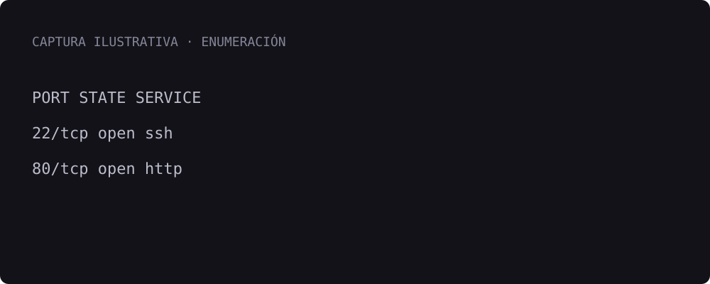

## Reconocimiento

Esta entrada es una **plantilla ilustrativa**, no la resolución de una máquina real. Sustituye estas notas por tus hallazgos y explica qué te hizo elegir cada paso.

```bash
nmap -sC -sV <IP>
```

Anota los puertos abiertos, las versiones y las primeras hipótesis. Un resultado solo es útil cuando explicas qué significa para la investigación.

## Enumeración web

Documenta las rutas y funcionalidades que encontraste. Añade las capturas junto a la explicación correspondiente.

[](https://app.hackthebox.com/machines)

```python
# Ejemplo de código con resaltado de sintaxis
servicios = ["http", "ssh"]
for servicio in servicios:
    print(f"Servicio identificado: {servicio}")
```

## Acceso inicial

Explica el hallazgo, sus requisitos y cómo verificaste el acceso. Incluye también los intentos descartados si aportan contexto.

## Escalada de privilegios

Recoge la enumeración local y la pista que permitió avanzar. Relaciona los comandos con el razonamiento detrás de ellos.

## Aprendizajes

- Qué técnica aprendiste.
- Qué harías de otra forma.
- Qué te gustaría investigar a continuación.
